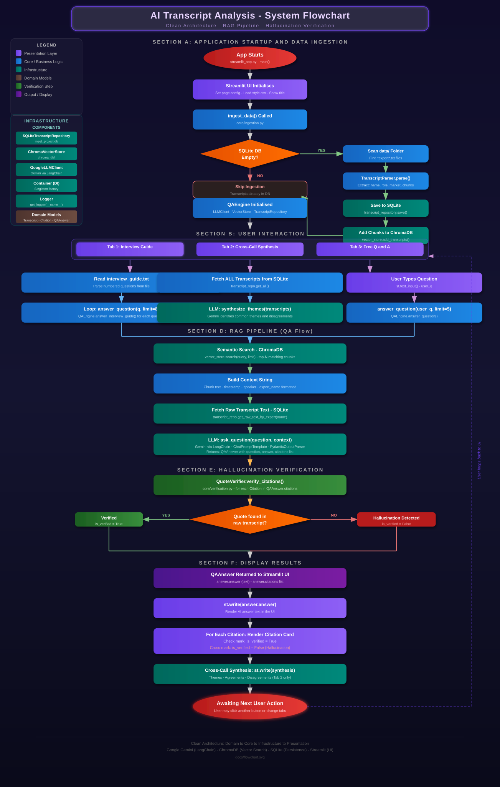

# Transcript Analysis Application

An AI-powered application that analyses expert interview transcripts. It answers predefined interview guide questions, synthesizes common themes across multiple calls, and — crucially — flags any AI-generated quote that cannot be verified against the original source text.

---

## ✨ Features

- **Interview Guide Q&A** — Answers predefined questions from the interview guide using relevant transcript context.
- **Cross-Call Synthesis** — Aggregates common themes and disagreements across all expert transcripts.
- **Free Q&A** — Ask any ad-hoc question across all transcripts.
- **Deterministic Hallucination Detection** — Every AI-generated quote is verified against the original source text. Unverified quotes are flagged with ❌ in the UI.

---

## 🗂️ Project Structure

```
├── data/                        # Transcript .txt files + interview_guide.txt
├── src/
│   ├── domain/                  # Core models, interfaces, exceptions (no dependencies)
│   ├── core/                    # Business logic: parsing, ingestion, QA, verification
│   ├── infrastructure/          # Database, vector store, LLM, logging, config
│   └── presentation/            # Streamlit UI
├── tests/                       # Pytest test suite
├── .env.example                 # Template for environment variables
├── pyproject.toml               # Project dependencies
└── README.md
```

---

## ⚙️ Prerequisites

Before you begin, ensure you have the following installed:

- **Python 3.13+** — [Download here](https://www.python.org/downloads/)
- **A Google Gemini API Key** — [Get one free here](https://aistudio.google.com/app/apikey)

---

## 🚀 Setup & Installation

### Step 1 — Clone the Repository

```bash
git clone <your-repository-url>
cd <repository-folder>
```

### Step 2 — Configure Your API Key

Copy the example environment file and add your key:

```bash
# On Windows (PowerShell)
Copy-Item .env.example .env

# On macOS/Linux
cp .env.example .env
```

Now open the `.env` file and replace the placeholder with your actual key:

```env
GOOGLE_API_KEY=your-google-api-key-here
MODEL_NAME=gemini-3.6-flash
```

> ⚠️ **Never commit your `.env` file.** It is already listed in `.gitignore`.

---

### Step 3 — Install Dependencies

Choose **one** of the two methods below:

---

#### Method A: Standard `pip` + Virtual Environment

```bash
# 1. Create a virtual environment
python -m venv .venv

# 2. Activate it
# On Windows:
.\.venv\Scripts\activate
# On macOS/Linux:
source .venv/bin/activate

# 3. Install all dependencies
pip install -e .
```

---

#### Method B: Using `uv` (Faster)

`uv` is a fast Python package manager. Install it first if you don't have it:

```bash
pip install uv
```

Then install the project:

```bash
uv sync
```

---

## ▶️ Running the Application

Make sure your virtual environment is active (or use `uv run`), then:

```bash
# Method A (standard venv):
python -m streamlit run src/presentation/streamlit_app.py

# Method B (uv):
uv run streamlit run src/presentation/streamlit_app.py
```

The app will open automatically in your browser at `http://localhost:8501`.

> 📝 **First run:** On the first launch, the app will automatically read transcript files from the `data/` folder, parse them, and load them into the local SQLite and ChromaDB databases. This only happens once — subsequent launches are instant.

---

## 🧪 Running Tests

```bash
# Method A (standard venv):
python -m pytest tests/

# Method B (uv):
uv run pytest tests/
```

---

## 📄 Adding Your Own Transcripts

Place `.txt` transcript files inside the `data/` folder. Each file must follow this format:

```
Expert – Full Name Here
Role: Their Role
Market: Their Market

00:00
Interviewer: Your question here?
Expert: Their response here.

00:05
Expert: Continued speech...
```

The filename must contain the word `expert` (e.g., `expert_4_john_doe.txt`).  
Delete the `meet_project.db` file and the `chroma_db/` folder to force a re-ingestion of all transcripts on the next launch.

---

## 🏗️ Architecture Overview

This application uses **Clean Architecture** — each layer only depends on the layer below it.

| Layer | Folder | Responsibility |
|---|---|---|
| Domain | `src/domain/` | Core data models (`Transcript`, `Citation`, `QAAnswer`), abstract interfaces, custom exceptions. No external dependencies. |
| Core | `src/core/` | Business logic: transcript parsing, data ingestion pipeline, QA orchestration (RAG), hallucination verification. |
| Infrastructure | `src/infrastructure/` | Concrete implementations: SQLite repository, ChromaDB vector store, Google Gemini LLM client, logging, config. |
| Presentation | `src/presentation/` | Streamlit UI — thin layer that calls `QAEngine` and displays results. |

---

## 🗺️ System Flowchart

The flowchart below visualises the complete application lifecycle — from startup and data ingestion through the RAG pipeline to hallucination verification and result display.



> 📄 The full-resolution SVG is at [`docs/flowchart.svg`](docs/flowchart.svg).
